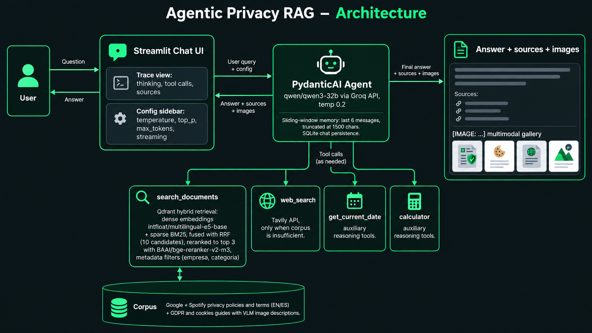

<div align="center">

# Asistente Experto en Privacidad con Agentic RAG

**Asistente conversacional sobre privacidad y protección de datos con RAG híbrido y agente con herramientas.**


</div>

## Demo

*Vídeo demo próximamente.*

## Arquitectura



## Aspectos destacados

- **RAG híbrido con reranking**: chunking recursivo (1000 caracteres, 15% solapamiento), embeddings multilingües E5, búsqueda densa + sparse BM25 con Reciprocal Rank Fusion y reranking con cross-encoder.
- **Agente con function calling**: decide cuándo buscar en el corpus, reformula queries y aplica filtros por empresa/categoría.
- **Búsqueda web como respaldo**: si el corpus no contiene la respuesta, el agente recurre a internet (Tavily) y combina ambas fuentes en la respuesta final.
- **Ingeniería de prompts**: comparativa de system prompts y temperaturas; prompt restrictivo anti-alucinaciones con abstención explícita.
- **Memoria y trazabilidad**: ventana deslizante conversacional, persistencia de chats en SQLite y vista de razonamiento, llamadas a tools y fuentes.
- **Soporte multimodal**: descripciones de imágenes generadas con VLM (`Qwen2.5-VL-7B-Instruct`) integradas en el corpus y mostradas en el chat.

## RAG vs Agentic RAG: hallazgos

| Caso | RAG clásico (Fase 2) | Agente (Fase 3) |
|---|---|---|
| Preguntas multi-intención | Filtros automáticos rígidos; pierde partes | Divide en búsquedas independientes; responde todo |
| Comparativas (Google vs Spotify) | Contexto insuficiente; se abstiene | Busca por separado y compara |
| Idioma de la query (ES/EN) | El retrieval se sesga al idioma del documento | Reformula la query; persiste cierto sesgo |
| Fuera de dominio / trampas | Se abstiene (scores ~0 + prompt restrictivo) | No usa tools innecesarias; contradice premisas falsas |
| Info fuera del corpus | Indica falta de información | Recurre a `web_search` y completa la respuesta |

El comportamiento está respaldado por unas **60 pruebas manuales** con sus outputs en los notebooks. La [fase 2](notebooks/fase2.ipynb) compara prompts, temperaturas y estrategias de chunking antes de evaluar el RAG por tipos de pregunta. La [fase 3](notebooks/fase3.ipynb) repite la batería contra el agente, con casos difíciles como preguntas multi-intención, información de una sola línea, temas fuera del corpus y preguntas trampa, y prueba además cada herramienta auxiliar por separado.

## Cómo ejecutar

<details>
<summary>Guía paso a paso (clic para expandir)</summary>

Prerrequisitos: Python 3.12+, [Docker Desktop](https://www.docker.com/products/docker-desktop/) y [uv](https://docs.astral.sh/uv/), más 3 API keys gratuitas:

- `GROQ_KEY`: [console.groq.com/keys](https://console.groq.com/keys)
- `TAVILY_API_KEY`: [app.tavily.com](https://app.tavily.com/)
- `HF_TOKEN`: [huggingface.co/settings/tokens](https://huggingface.co/settings/tokens)

```bash
# 1. Clonar y entrar en el proyecto
git clone https://github.com/AndresCorSan/PECL_LLMs.git
cd PECL_LLMs

# 2. Configurar claves
copy .env.example .env   # y rellenar los 3 valores (en Linux/Mac: cp)

# 3. Levantar Qdrant
docker compose up -d

# 4. Instalar dependencias con uv (crea `.venv` y las fija según `uv.lock`)
uv sync

# 5. Indexar el corpus (solo la primera vez; descarga los modelos E5/BM25/BGE)
uv run python ingest.py

# 6. Lanzar la app
uv run streamlit run app.py
```

Alternativa sin `uv`, con pip clásico: `python -m venv .venv`, activarlo y `pip install -r requirements.txt`.

</details>

## Estructura del proyecto

```
app.py                    # Entrada Streamlit
ingest.py                 # Ingesta del corpus en Qdrant (uso puntual)
notebooks/                # Desarrollo por fases: embeddings, RAG, agente
scripts/                  # Scraping del corpus y descripciones VLM (uso puntual)
streamlit_app/agent/      # Agente, tools y retrieval sobre Qdrant
streamlit_app/ui/         # Chat, sidebar y pantalla de carga
streamlit_app/utils/      # Sesión, SQLite y títulos automáticos
corpus/                   # Documentos en Markdown + imágenes
docs/                     # Diagrama de arquitectura (+ vídeo demo futuro)
```

- `notebooks/` documenta el proceso de desarrollo por fases (experimentación, comparativas y pruebas del RAG y del agente).
- `streamlit_app/` es la aplicación con UI que integra el pipeline completo, con memoria conversacional, persistencia y trazabilidad, lista para usar.

## Corpus

### Contenido actual del corpus

| Categoría | Documento | Idioma | Tamaño |
|---|---|---|---|
| `privacy_policies` | Política de privacidad de Google | EN | ~36 KB |
| `privacy_policies` | Política de privacidad de Spotify | ES | ~35 KB |
| `terms` | Términos de uso de Google | EN | ~33 KB |
| `terms` | Términos de uso de Spotify | ES | ~42 KB |
| `guides` | Guía explicativa del GDPR (+ 2 imágenes) | EN | ~14 KB |
| `guides` | Guía sobre cookies (+ 4 imágenes) | EN | ~13 KB |

Corpus multilingüe (inglés/español) que permite analizar el efecto del idioma en la recuperación semántica.

### Cómo se extrajo

Con `extraer_corpus.py` (`scripts/`): descarga el HTML de cada URL del diccionario `SOURCES`, elimina navegación y etiquetas de código, convierte el contenido a Markdown preservando títulos, listas y tablas, y lo guarda en `corpus/<categoria>/<nombre>.md` con su URL de origen en la cabecera. Las imágenes de las guías se describen con `scripts/describir_imagen.py` (VLM `Qwen2.5-VL-7B-Instruct` vía HuggingFace) y sus descripciones se integran en el Markdown con etiquetas `[IMAGE: ...]` que el chat usa para mostrar la galería.

### Cómo ampliarlo

El diseño admite más empresas, categorías y guías: basta añadir URLs a `SOURCES` en `extraer_corpus.py`, regenerar los `.md` y reindexar la colección de Qdrant. Solo habría que extender dos piezas pequeñas del retrieval: las palabras clave de `detectar_empresas` y las descripciones de categoría en `make_detectar_categorias`.

## Consideraciones técnicas y siguientes pasos

**Por qué estos parámetros:**

- **Chunking recursivo 1000/15%**: en pruebas ganó al de tamaño fijo (500/50, cortaba frases) y al recursivo de 600; da más contexto por fragmento y respeta la estructura Markdown, fusionando títulos aislados con el chunk siguiente.
- **Prompt restrictivo + temperatura 0.2**: minimiza alucinaciones y estabiliza respuestas; el modelo solo usa el contexto recuperado, admite respuestas parciales y se abstiene si falta información.
- **`web_search` solo como respaldo**: el prompt lo reserva para cuando el corpus no basta; calibrarlo costó varias iteraciones (demasiada restricción y nunca la usaba, demasiado poca y abusaba de ella).
- **Reranking 10→3**: el cross-encoder es lo más caro del pipeline; reordenar 10 candidatos y quedarse con 3 equilibra precisión y latencia/coste.

**A tener en cuenta:**

- Corpus cerrado (Google/Spotify + 2 guías): no sabe de otras empresas; el agente lo compensa con búsqueda web.
- Ventana de contexto de 6 mensajes y truncado a 1500 caracteres por límites de la API gratuita de Groq.
- Recuperación limitada a top 10 candidatos y top 3 tras reranking, con umbral mínimo de similitud 0.2 para el filtro de categoría: fuera de esos márgenes, el sistema se abstiene.
- Preguntas comparativas globales con poco contexto recuperado pueden quedar sin respuesta.
- Siguiente paso: evaluación cuantitativa (recall@k, groundedness, tasa de abstención).

## Autor

**Andrés Corbacho Sánchez**
Diseño y desarrollo end-to-end: pipeline RAG híbrido, agente con herramientas, backend de retrieval con Qdrant e interfaz de chat en Streamlit.

[](https://github.com/AndresCorSan)
[](https://www.linkedin.com/in/andres-corbacho)

Licencia: MIT (ver `LICENSE`).
